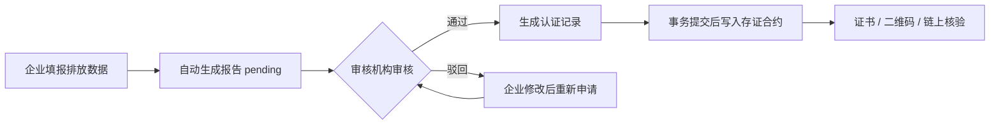
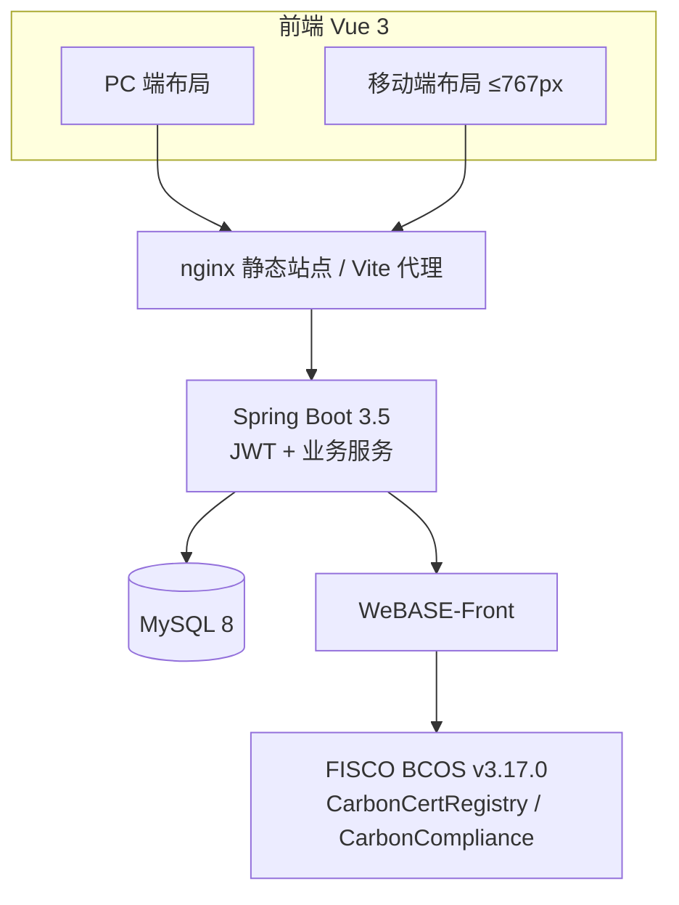

# 碳链通 · 基于区块链的企业碳排放数据认证与追溯系统

面向企业碳排放数据的 **填报 → 审核 → 认证 → 上链存证 → 公众核验** 全流程平台。

认证存证由 Solidity 智能合约承载，部署在 FISCO BCOS 联盟链的 WeBASE 上；Spring Boot 通过
WeBASE-Front 的 REST 接口调用合约。业务库（MySQL）只保存业务数据与展示字段，**不保存任何哈希**。
公众可用电子防伪码或证书二维码在公共端核验真伪，核验以链上存证为唯一依据。

平台**不含任何自实现的区块链**。

---

## 1. 系统概览



| 端 | 页面数 | 主要能力 |
| --- | --- | --- |
| 企业端 | 7 | 企业首页、排放填报、排放趋势、报告记录、认证申请、证书查看与下载、CBAM 合规申报 |
| 审核端 | 4 | 审核工作台、待审核报告、今日审核、审核历史 |
| 监管端 | 9 | 监管总览、企业管理、审核机构管理、排放因子管理、认证管理（撤销）、CBAM 申报管理、行业统计、异常监控、用户管理 |
| 公共端 | 4 | 电子防伪码查询、二维码验证、企业排放信息、认证有效性验证（全部免登录） |
| 通用 | 2 | 登录、个人中心（含头像上传、修改密码、偏好设置） |

### 工程规模

| 项目 | 数量 |
| --- | --- |
| 后端 Controller / REST 接口 | 18 / 107 |
| 实体与 Mapper | 21 / 21 |
| 业务 Service | 16 |
| 前端视图文件 | 28（24 个业务页 + 登录、个人中心 + 2 个布局） |
| 前端接口模块 | 16 |
| 智能合约 | 2（存证合约 14 个外部函数、合规合约 18 个外部函数） |
| 业务数据表 | 22（11 张业务表 + 11 张 CBAM 表） |

---

## 2. 核心能力

- **链上存证与核验**：认证、撤销、作废都写入 `CarbonCertRegistry`，证书状态（`VALID / REVOKED / INVALID`）以链上为准，业务库仅作展示。
- **合规判定上链**：配额、环比波动、活动数据为 0、排放因子不符、迟报五类规则由 `CarbonCompliance` 判定并返回结果位掩码；链不可用时可按配置回退到本地 Java 规则。
- **证书体系**：真实可扫描二维码（`qrcode`）、证书详情弹窗、横向 A4 PDF 下载（`jsPDF` + Canvas 绘制），PDF 与弹窗内均含认证专用章与核验二维码。
- **扫码核验**：公共端支持摄像头逐帧识别（`jsQR`），也支持拍照 / 上传二维码图片识别；识别后自动定位防伪码并查询。
- **全站移动端**：以 767px 为断点，24 个业务页均有卡片化移动版本，含底部胶囊导航、抽屉菜单、底部抽屉式弹窗。
- **数据可视化与预警**：ECharts 排放趋势、行业排名与占比；异常数据按级别展示并支持处理。
- **CBAM 合规申报（P0）**：产品目录（CN 编码/行业/示例默认值）、生产装置、产品级隐含排放（直接+间接，实测或默认值）、欧盟认可核查机构与装置级核查报告；按年度生成申报包、完整性校验、JSON 导出与监管确认/退回；排放数据版本号 + 每小时定时对账，自动识别“已确认快照落后于实时数据”。

### CBAM 合规能力（P0）

CBAM 正式期自 2026-01-01 起要求以「装置 / 产品（CN 编码）」为单位申报隐含排放，实际排放须经欧盟国家认可机构（NAB）认可的核查机构核查，年度申报截止次年 9 月 30 日。

平台已补全的最小闭环：

| 能力 | 实现 |
| --- | --- |
| 主数据 | `cbam_goods` 产品目录（6 个行业示例）、`cbam_installations` 装置档案 |
| 核算 | `cbam_product_emissions` 按年度 × 产品 × 装置登记，直接/间接排放 = 产量 × 强度，支持 actual / default |
| 核查 | `cbam_verifiers` + `cbam_verification_reports`；actual 数据必须有 verified 报告，否则申报包判为缺失 |
| 申报 | `cbam_declarations` 按企业 + 年度唯一，生成 JSON 快照，完整性校验后提交，监管端确认/退回 |
| 版本与对账 | `cbam_data_versions` 按企业 + 年度记录数据版本，排放增删改即 +1；申报包生成时冻结 `data_version`；`cbam_reconciliation_logs` 保存每小时定时/手动对账结果，每日 03:30 清理 90 天前日志 |
| 事件同步 | 事务性 Outbox（`cbam_outbox`）→ RabbitMQ（`cbam.events`）→ 监管幂等收件箱（`cbam_regulator_inbox`）；投递失败指数退避重试，毒消息进死信队列 |
| 页面 | 企业端「CBAM 合规申报」、监管端「CBAM 申报管理」（含数据一致性、立即对账、对账记录） |

> 定时对账默认每小时整点执行（`carbon.cbam.reconcile-cron` 可改），监管端也可「立即对账」；
> 版本号可识别“增删后合计不变”的隐性漂移，避免只靠总量比对漏判。
> Outbox→RabbitMQ 默认关闭（`carbon.cbam.outbox.mq-enabled=false`），演示环境在 `application-ubuntu.yml`
> 中开启并连接本机 RabbitMQ；消费失败进死信队列，投递失败指数退避重试。
> 演示栈需安装 RabbitMQ 4.x 并创建用户（`carbon / carbon123`，授予 `/` vhost 权限）；
> 未安装时可保持 `mq-enabled=false`，事件会保留在 `cbam_outbox` 等待后续投递。

> 边界：P0 不写链（P1 再接存证）、不做 CBAM Registry 报文格式转换；产品目录中的默认值为演示数值，
> 正式使用前需导入欧盟 2026 官方默认值（Default values definitive period）。

---

## 3. 技术栈

| 层次 | 技术 |
| --- | --- |
| 前端 | Vue 3.4 + Vite 5 + Element Plus 2.6 + ECharts 5.5 + Pinia + Vue Router（Hash 模式） |
| 前端特色库 | `qrcode`（生成真实二维码）、`jsqr`（摄像头/图片解码）、`jspdf`（证书 PDF） |
| 后端 | Spring Boot 3.5.16 + MyBatis-Plus 3.5.9 + JDK 25 + Lombok 1.18.48 |
| 数据库 | MySQL 8.x（库名 `carbon_emission`，utf8mb4） |
| 消息队列 | RabbitMQ 4.x + Spring AMQP（CBAM 事务性 Outbox 投递，死信队列 + 消费幂等） |
| 区块链 | FISCO BCOS v3.17.0 + WeBASE 3.1.1（Front / Sign）+ Solidity 0.8.x |
| 链上调用 | Spring Boot → WeBASE-Front REST（`/trans/handle` 等），不依赖区块链 SDK |
| 鉴权 | JWT（有效期 24 小时）+ 拦截器 + 角色校验 + 企业数据隔离 |

---

## 4. 系统架构



后端通过 `ChainGateway` 抽象链访问，提供两种实现：

- `WebaseChainGateway`：真实联盟链，经 WeBASE-Front 调合约；
- `StubChainGateway`：离线开发桩，无区块、不落盘、重启清空，仅用于本机启动与接口回归。

---

## 5. 目录结构

```text
碳链通/
├── houduan/                        后端（Spring Boot）
│   ├── contracts/                  CarbonCertRegistry.sol / CarbonCompliance.sol / deploy-contracts.sh
│   ├── src/main/java/com/carbon/trace/
│   │   ├── chain/                  链网关、WeBASE 实现、离线桩、历史数据迁移、对账
│   │   ├── common/                 JWT、鉴权拦截器、异常处理、电子防伪码、数据隔离
│   │   ├── config/                 WebMvc、安全响应头、MyBatis-Plus、Jackson
│   │   ├── controller/             18 个控制器
│   │   ├── entity/ mapper/         21 个实体与 Mapper
│   │   └── service/impl/           16 个业务服务
│   ├── src/main/resources/         application.yml、chain/*.abi.json
│   ├── api-tests.ps1               接口回归脚本（96 项断言，含 CBAM/对账/Outbox）
│   └── mvnw / mvnw.cmd             Maven 包装器
├── qianduan/                       前端（Vue 3 + Vite）
│   ├── src/api/                    16 个接口模块 + 统一 request 封装
│   ├── src/assets/styles/          global.css、mobile.css（移动端设计层）
│   ├── src/composables/            useDevice、useAutoRefresh、useECharts
│   ├── src/router/ store/ utils/
│   └── src/views/                  28 个视图（enterprise / auditor / regulator / public）
├── database/                       建表与增量 SQL
├── docs/                           设计方案（DOCX / PPTX）与接口清单
├── qidonqi/                        一键启动脚本（WSL Ubuntu / Windows 开发）
├── carbon-trace-design/            设计方案 HTML（GitHub Pages 部署源）
└── .github/workflows/pages.yml     Pages 自动部署工作流
```

> `target/`、`dist/`、`node_modules/`、`uploads/`、`*.log` 与本地链配置均已在 `.gitignore` 中忽略，仓库不包含构建产物。

---

## 6. 环境要求

- **JDK 25**（Spring Boot 3.5 支持 Java 17–25，本项目以 25 构建与运行）
- Maven（直接使用项目自带 `mvnw` / `mvnw.cmd`）
- **Node.js 18+**
- **MySQL 8.x**
- 可选：FISCO BCOS v3.17.0 节点 + WeBASE 3.1.1（Front 5002 / Sign 5004）
  - 群组标识为 `group0`（WeBASE 1.5.x / FISCO BCOS 2.x 才是 `1`）
  - 编译合约需 **solc 0.8.30**（`--via-ir --evm-version london`）；WeBASE 内置 0.8.11 无法编译本项目合约
  - 本机开发可不装链：后端默认 `carbon.chain.mode=stub`

---

## 7. 快速开始

### 7.1 初始化数据库

```sql
CREATE DATABASE carbon_emission DEFAULT CHARACTER SET utf8mb4;
```

`database/` 脚本建议按顺序执行：

`carbon_emission_db.sql` → `03_profile_settings.sql` → `04_regulator_organizations.sql`
→ `05_sync_triggers.sql` → `06_align_schema.sql` → `07_align_all_schema.sql` → `08_user_avatar.sql`
→ `09_cbam.sql` → `10_cbam_version_reconcile.sql` → `11_cbam_outbox.sql`

> 注意：`carbon_emission_db.sql` 与 `05_sync_triggers.sql` 仍保留已下线链表 `blocks`、`block_transactions` 的建表语句。
> 当前实际库结构为 **22 张表（11 张业务表 + 11 张 CBAM 表）、无任何哈希列**；如用脚本重建库，请先按现状更新这两处。

数据库连接在 `houduan/src/main/resources/application.yml`，默认 `root / 123456`，请按本机实际修改。

### 7.2 启动后端

```powershell
cd houduan
$env:JAVA_HOME = "C:\Program Files\Microsoft\jdk-25.0.4.101-hotspot"
.\mvnw.cmd spring-boot:run
```

服务监听 **8080**。`stub` 模式下启动日志会打印醒目的离线桩 WARN 横幅。

### 7.3 启动前端

```powershell
cd qianduan
npm install
npm run dev
```

访问 **http://localhost:5173**。Vite 已代理 `/api`、`/uploads` 到 `http://localhost:8080`，
并将监听地址设为 `0.0.0.0`，同一局域网内的手机可直接访问开发服务器。

### 7.4 一键启动脚本（Windows）

| 命令 | 行为 |
| --- | --- |
| `qidonqi\启动系统.bat` | 启动 WSL Ubuntu 演示栈，等待接口就绪后打开浏览器，并检查 HTTP/HTTPS 局域网映射 |
| `qidonqi\启动系统.bat dev` | 仅启动 Windows 本地开发环境（stub 后端 8080 + Vite 5173） |
| `qidonqi\启动系统.bat deploy` | 构建最新后端 jar 与前端 dist，同步到 `/opt/carbon-trace` 并重启 `carbon-trace` |

`start-ubuntu.ps1` 会依次拉起 WSL 发行版、启动并检查 systemd 服务、轮询后端接口，最后输出
本机与局域网访问地址（`http://<内网IP>:8088`、`https://<内网IP>:8443`）以及证书下载地址。
`deploy.ps1` 会先完成两个构建再停止旧服务，jar 采用 `.new → mv` 原子替换，并保留上一版
`carbon-trace.jar.prev` 作为回滚点。

### 7.5 本机演示部署（可选）

Ubuntu 侧使用 systemd 服务 `carbon-trace`，目录约定：

```text
/opt/carbon-trace/
├── app/         后端 jar 与 application-ubuntu.yml
├── web/         前端 dist
├── uploads/     上传文件
└── logs/
```

nginx 提供 HTTP 80 与 HTTPS 站点；Windows 侧通过端口映射供局域网访问：

| Windows 监听 | 转发到 WSL | 用途 |
| --- | --- | --- |
| `0.0.0.0:8088` | `127.0.0.1:80` | 局域网 HTTP 访问 |
| `0.0.0.0:8443` | `127.0.0.1:4430` | 局域网 HTTPS（扫码 / 摄像头） |

> HTTPS 站点在 WSL 内监听 4430，是为了避开 Windows 上其他软件对 443 的占用；
> 对外地址仍是 `https://<内网IP>:8443`。以上端口映射属于宿主机配置，不在仓库内。

---

## 8. 接入联盟链

```bash
# 1) 确认链与 WeBASE-Front 已启动
curl http://127.0.0.1:5002/WeBASE-Front/group0/web3/blockNumber

# 2) 准备签名账户（二选一）
#    a. WeBASE-Sign 托管（推荐生产，私钥不出 Sign 服务）
curl -X POST 'http://127.0.0.1:5002/WeBASE-Front/privateKey?type=2&userName=carbon-backend'
#    b. Front 本地私钥（演示环境最省事）
curl 'http://127.0.0.1:5002/WeBASE-Front/privateKey?groupId=group0&type=0&userName=carbon-backend'

# 3) 编译 → 部署两个合约 → 注册 ABI（需要 solc 0.8.30）
cd houduan/contracts
./deploy-contracts.sh --user 0x<address> --solc /usr/local/bin/solc-0.8.30
#    可追加 --out /opt/carbon-trace/application-ubuntu.yml 直接生成配置片段
```

通过环境变量或 `application-local.yml`（已忽略，不入库）提供真实配置：

| 环境变量 | 说明 |
| --- | --- |
| `CARBON_CHAIN_MODE` | `stub`（默认）或 `webase` |
| `CARBON_WEBASE_URL` | WeBASE-Front 地址，默认 `http://127.0.0.1:5002` |
| `CARBON_CHAIN_GROUP_ID` | 群组标识，默认 `group0` |
| `CARBON_CHAIN_SIGN_USER_ID` | WeBASE-Sign 托管用户 ID |
| `CARBON_CHAIN_USER_ADDRESS` | 本地私钥账户地址（与 Sign 二选一） |
| `CARBON_CHAIN_REGISTRY_ADDRESS` | 存证合约地址 |
| `CARBON_CHAIN_COMPLIANCE_ADDRESS` | 合规合约地址 |
| `CARBON_JWT_SECRET` | 生产必须覆盖的 JWT 密钥 |

> 任何配置都不得出现私钥。演示环境已将 WeBASE-Front(5002) / Node-Mgr(5001) / Sign(5004)
> 与 MySQL 绑定在 `127.0.0.1`，避免无鉴权的联盟链接口对外暴露。

历史认证记录可通过 `carbon.chain.migration.enabled=true` 一次性写入链上（以业务库为准），完成后请改回 `false`。

---

## 9. 测试账号

| 角色 | 用户名 | 密码 | 说明 |
| --- | --- | --- | --- |
| 企业端 | `enterprise01` | `123456` | 数据填报、认证申请、证书查看 |
| 监管端 | `regulator01` | `123456` | 企业 / 机构 / 因子管理、撤销认证、处理告警 |
| 审核端 | `auditor01` | `123456` | 报告审核（通过 / 驳回） |
| 系统管理员 | `admin` | `123456` | 超级角色，拥有全部权限 |

---

## 10. 接口与回归测试

- 后端共 **18 个 Controller、107 个 REST 接口**，完整清单见 [docs/接口清单.md](docs/接口清单.md)。
- 免登录白名单：`/api/auth/login`、`/api/public/**`、`/api/certifications/by-fingerprint/**`、
  `/api/certifications/verify`。
- 登录态通过 `Authorization: Bearer <token>` 传递；角色取值 `enterprise / auditor / regulator / admin`。

后端启动后执行接口回归：

```powershell
cd houduan
powershell -ExecutionPolicy Bypass -File api-tests.ps1
```

脚本分 10 组共 **96 项断言**（认证、公共端、认证记录、角色越权、监管机构、企业管理、统计、
其他业务、链模式与合规判定、CBAM 合规/对账/Outbox），全部通过时退出码为 0。stub 模式下会播种演示证书，
因此防伪码核验、示例证书等断言与真实链行为一致；CBAM 组依赖 `09_cbam.sql`、`10_cbam_version_reconcile.sql`
与 `11_cbam_outbox.sql` 的种子/迁移数据。

---

## 11. 核心业务规则

1. **三表同号**：排放记录、报告记录、认证记录共用同一编号（`CR + 6 位序号`），链上以该编号为存证唯一键。
2. **认证链路**：企业填报 → 自动生成报告（`pending`）→ 审核通过（`certified`）→ 生成认证记录并上链；
   驳回（`rejected`）后可重新申请。
3. **电子防伪码**：填报时随机生成 12 位字符串，是链上存证的映射索引；查询/核验大小写敏感、精确匹配。
4. **核验以链为准**：证书状态取自链上，业务表中的防伪码仅作展示回填，被改动不影响核验结果。
5. **上链时机**：链写入不受数据库事务保护，统一延迟到事务提交后（`afterCommit`）执行；
   失败自动重试，最终失败生成 `chain_failed` 高危告警。
6. **撤销终局**：仅监管端 / 管理员可撤销，撤销原因必填；撤销同样写链，状态变为 `REVOKED` 且不可再次认证。
7. **链上只追加**：删除排放记录只把链上存证标记为作废（`INVALID`），历史留痕不可抹除。
8. **合规判定由合约执行**：年度配额、环比波动（阈值可治理，基点制）、活动数据为 0、排放因子不符、
   迟报五类规则在 `CarbonCompliance` 内判定并返回位掩码；告警级别与中文文案由后端生成。
9. **一致性对账**：启动时与每隔 `carbon.chain.integrity-interval-ms`（默认 5 分钟）比对链上计数与业务库
   有效 / 已撤销记录数；已作废存证只存在于链上，差额属预期。
10. **企业数据隔离**：列表接口强制过滤 `enterpriseId`，单条读写校验归属，伪造其他企业编号一律 403
    （`UserScopes` 统一实现）。

---

## 12. 安全设计

- **上传校验**：5MB 上限；按 magic bytes 识别 jpg / png / gif / webp，拒绝扩展名与内容不一致；
  落盘名为 UUID + 真实扩展名；路径归一化防穿越；错误信息不泄露服务器路径。
- **安全响应头**：全站 `X-Content-Type-Options: nosniff`；`/uploads/**` 额外返回
  `Content-Security-Policy: default-src 'none'; sandbox` 与 `X-Frame-Options: DENY`。
- **CORS**：默认不放行任何跨域来源（同域部署）；仅在 `CARBON_CORS_ALLOWED_ORIGINS` 白名单下放行，
  且 `allowCredentials=false`，登录态只走 `Authorization` 头。
- **账号安全**：密码以 BCrypt 哈希存储，启动时幂等迁移历史明文；连续 5 次登录失败锁定 5 分钟（HTTP 429）；
  用户资料更新走字段白名单，`role / status` 仅监管 / 管理员可改。
- **JWT**：24 小时有效期；生产必须用 `CARBON_JWT_SECRET` 覆盖仓库默认值。
- **链服务边界**：WeBASE 各端口仅绑定本机回环地址；配置中不落私钥，只持有 `signUserId` 或账户地址。

---

## 13. 移动端与二维码核验

### 移动端

- 断点 **767px**，`useDevice()` 统一判断手机布局；移动端样式集中在 `src/assets/styles/mobile.css`。
- 全部 22 个业务页均提供移动版本：统计块、卡片列表、单列表单、底部抽屉弹窗；
  顶部为菜单按钮 + 页面标题，底部为悬浮胶囊导航（前 4 项 + 「更多」）。
- 已在 360px / 390px 宽度逐页验证：无横向溢出、无控制台报错。

### 二维码

- 证书二维码由 `qrcode` 实时生成，内容为公共核验链接：
  `https://<访问主机>:8443/#/public/query?fp=<电子防伪码>`，手机扫码后自动带出防伪码并查询。
- 证书详情弹窗展示二维码与横排印章；下载 PDF 时二维码与印章会一并绘制进 A4 横向证书。
- 公共端「二维码验证」支持摄像头逐帧识别与拍照 / 上传图片识别，识别成功后自动验证。
- **摄像头需要安全上下文**（HTTPS 或 localhost）：
  - 局域网请使用 `https://<内网IP>:8443`，自签证书可从 `http://<内网IP>:8088/carbon.crt` 下载安装；
  - HTTP 页面下无法调用实时摄像头，但可用「拍照 / 上传二维码」调起系统相机完成识别。

---

## 14. 常见问题

**Q：IDE 里 `service/impl` 大面积报「找不到符号」？**
A：确认使用 JDK 25 构建；`pom.xml` 已显式声明 Lombok 1.18.48 注解处理器。仍报错时执行
`Java: Clean Java Language Server Workspace` 后重载窗口。

**Q：WeBASE 没启动会怎样？**
A：`webase` 模式下链相关调用返回 503，认证 / 撤销 / 核验失败；填报流程中的告警判定会按
`fallback-to-java` 回退本地规则，不中断填报。`stub` 模式完全不依赖 WeBASE，但链上没有真实存证。

**Q：改了业务表里的电子防伪码，前端还能查到吗？**
A：能。查询与核验走链上存证，业务表改动不影响核验结果（设计预期）。

**Q：区块列表与交易哈希从哪来？**
A：区块来自 `GET /api/blockchain`（后端调 WeBASE-Front `web3/blockByNumber`）；交易哈希在写交易时
从回执缓存，历史查询通过解析区块内 `certify` 交易入参获得（按 ABI 现算选择器并本地解码）。
不使用 WeBASE 3.x 的事件查询接口，避免其「订阅 + 超时」导致结果不稳定。

**Q：部署合约报 `Stack too deep` / `Execution invalid opcode`？**
A：前者说明编译器版本过低（需 ≥ 0.8.13 且开启 `--via-ir`），后者是 EVM 版本高于链支持的 `london`。
`deploy-contracts.sh` 已固定 `--evm-version london --via-ir`，请配 `--solc /usr/local/bin/solc-0.8.30`。

**Q：WeBASE 3.x 调用合约时 `funcParam` 怎么传？**
A：`funcParam` 是 `List<String>`，元素按原文参与 ABI 编码：字符串直接给内容（不要加引号）、
数字给 `1000`、数组给 `["0x..."]`。后端 `WebaseChainGateway#encodeFuncParams` 已统一处理。

**Q：登录提示「失败次数过多，账号已临时锁定」？**
A：连续 5 次密码错误锁定 5 分钟（内存计数，重启服务即解锁）。可用 `admin` 在用户管理中重置密码。

**Q：局域网扫码提示摄像头不可用？**
A：网页摄像头要求 HTTPS。改用 `https://<内网IP>:8443` 并安装 `/carbon.crt` 证书，
或在 HTTP 页面使用「拍照 / 上传二维码」识别。

**Q：本机 nginx HTTPS 与 Steam++ / Watt Toolkit 的 GitHub 加速冲突？**
A：两者都会占用本机 443。演示环境将 nginx SSL 监听改为 4430，并把 Windows 的
`8443 → 127.0.0.1:4430` 映射同步更新，对外地址保持不变，即可同时保留扫码 HTTPS 与 GitHub 加速。

---

## 15. 已知待办

- `database/` 部分脚本仍保留已下线的 `blocks`、`block_transactions` 建表语句，需按当前 11 张表更新。
- 合约治理（`addWriter` / `removeWriter`）目前通过 WeBASE-Front 控制台或脚本执行，尚未提供平台内入口。
- 合约升级仍采用「部署新合约 + 迁移数据」，未引入代理合约（可升级模式）。
- 演示账号统一弱密码 `123456`（已有登录锁定缓解），可考虑增加「首次登录强制改密」。

---

## 16. 项目文档

| 文档 | 说明 |
| --- | --- |
| [docs/接口清单.md](docs/接口清单.md) | 全部 REST 接口、权限与返回码 |
| [docs/企业碳排放认证与溯源系统设计方案.docx](docs/企业碳排放认证与溯源系统设计方案.docx) | 设计方案 Word 版 |
| [docs/碳链通-企业碳排放认证与溯源系统方案.pptx](docs/碳链通-企业碳排放认证与溯源系统方案.pptx) | 汇报 PPT |
| [carbon-trace-design/](carbon-trace-design/) | 设计方案 HTML，推送后由 GitHub Pages 自动发布 |
