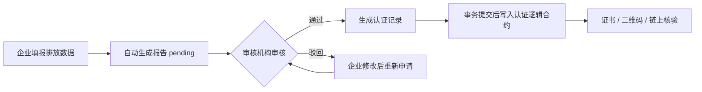
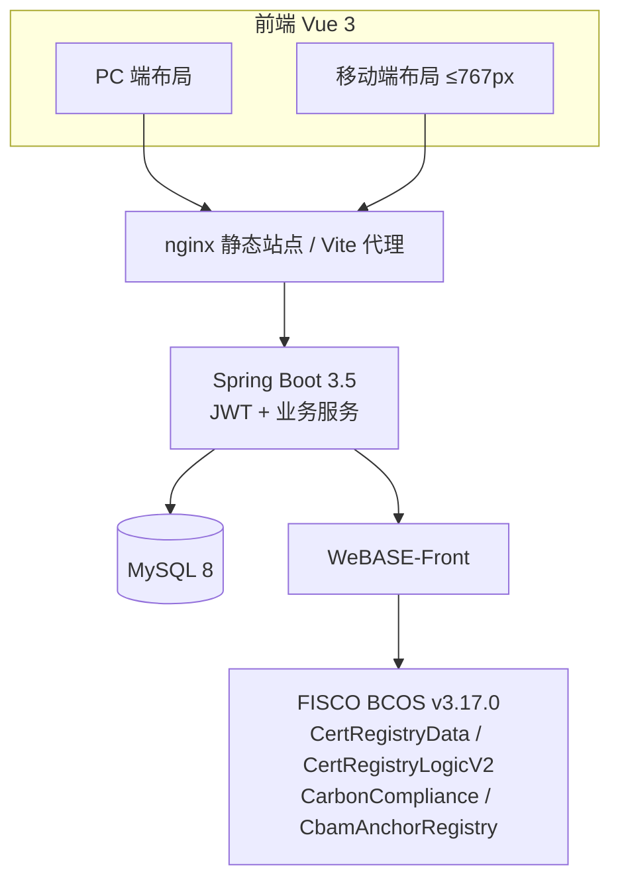

# 碳链通 · 基于区块链的企业碳排放数据认证与追溯系统

面向企业碳排放数据的 **填报 → 审核 → 认证 → 上链存证 → 公众核验** 全流程平台。

认证存证由 Solidity 智能合约承载，部署在 FISCO BCOS 联盟链的 WeBASE 上；Spring Boot 通过
WeBASE-Front 的 REST 接口调用合约。业务库（MySQL）只保存业务数据与展示字段；链上交易哈希与区块高度
仅在查询时由链网关回填，**不参与任何业务判断**。
公众可用电子防伪码或证书二维码在公共端核验真伪，核验以链上存证为唯一依据。

平台**不含任何自实现的区块链**。

---

## 1. 系统概览



| 端 | 页面数 | 主要能力 |
| --- | --- | --- |
| 企业端 | 7 | 企业首页、排放填报、排放趋势、报告记录、认证申请、证书查看与下载、CBAM 合规申报 |
| 审核端 | 4 | 审核工作台、待审核报告、今日审核、审核历史 |
| 监管端 | 10 | 监管总览、企业管理、审核机构管理、排放因子管理、认证管理（撤销）、CBAM 申报管理、行业统计、异常监控、链上治理、用户管理 |
| 公共端 | 4 | 电子防伪码查询、二维码验证、企业排放信息、认证有效性验证（全部免登录） |
| 通用 | 2 | 登录、个人中心（含头像上传、修改密码、偏好设置） |

### 工程规模

| 项目 | 数量 |
| --- | --- |
| 后端 Controller / REST 接口 | 19 / 111 |
| 实体与 Mapper | 21 / 21 |
| 业务 Service | 16 |
| 前端视图文件 | 29（25 个业务页 + 登录、个人中心 + 2 个布局） |
| 前端接口模块 | 17 |
| 智能合约 | 5 个 Solidity 文件（认证数据合约 + 认证逻辑 V1/V2 + 合规合约 + CBAM 锚点合约）；ABI 函数数：逻辑 V2 20、合规 34、数据合约 22、锚点 7（均含 public 常量 getter） |
| 业务数据表 | 22（11 张业务表 + 11 张 CBAM 表） |

> **实体 21 / 表 22**：`cbam_reconciliation_logs_archive` 是 90 天前对账日志的归档表，
> 由 `CbamReconciliationLogMapper` 的注解 SQL 直接读写，没有独立实体与 Mapper，因此实体数比表数少 1。

---

## 2. 核心能力

- **链上存证与核验**：认证、撤销、作废都写入认证逻辑合约，证书状态（`VALID / REVOKED / INVALID`）以链上为准，业务库仅作展示。认证合约采用「逻辑与数据分离」：`CertRegistryData` 只保存状态，生产推荐 `CertRegistryLogicV2`（在 V1 业务规则上增加 `highestCertSeq` 最高序号视图；部署脚本默认 V1，需显式传 `--logic-contract CertRegistryLogicV2`）；升级只需部署新逻辑并调用 `updateLogic`，历史存证无需迁移。
- **合规判定上链**：配额、环比波动、活动数据为 0、排放因子不符、迟报五类规则由 `CarbonCompliance` 判定并返回结果位掩码；链不可用时可按配置回退到本地 Java 规则。
- **证书体系**：真实可扫描二维码（`qrcode`）、证书详情弹窗、横向 A4 PDF 下载（`jsPDF` + Canvas 绘制），PDF 与弹窗内均含认证专用章与核验二维码。
- **扫码核验**：公共端支持摄像头逐帧识别（`jsQR`），也支持拍照 / 上传二维码图片识别；识别后自动定位防伪码并查询。
- **全站移动端**：以 767px 为断点，25 个业务页均有卡片化移动版本，含底部胶囊导航、抽屉菜单、底部抽屉式弹窗。
- **数据可视化与预警**：ECharts 排放趋势、行业排名与占比；异常数据按级别展示并支持处理。
- **CBAM 合规申报（P1）**：产品目录（CN 编码/行业/示例默认值）、生产装置、产品级隐含排放（直接+间接，实测或默认值）、欧盟认可核查机构与装置级核查报告；按年度生成申报包、完整性校验、JSON 导出与监管确认/退回；排放数据版本号 + 每小时定时对账，自动识别“已确认快照落后于实时数据”。申报包提交时把快照哈希与数据版本写入 `CbamAnchorRegistry` 作为链上锚点。
- **链上治理**：监管端「链上治理」页可查看存证 / 合规 / CBAM 锚点三类合约的地址、owner 与签名账户写入权限，管理员可增删 writer（真实写链）。

### CBAM 合规能力（P1）

CBAM 正式期自 2026-01-01 起要求以「装置 / 产品（CN 编码）」为单位申报隐含排放，实际排放须经欧盟国家认可机构（NAB）认可的核查机构核查，年度申报截止次年 9 月 30 日。

平台已补全的最小闭环：

| 能力 | 实现 |
| --- | --- |
| 主数据 | `cbam_goods` 产品目录（6 个行业示例）、`cbam_installations` 装置档案 |
| 核算 | `cbam_product_emissions` 按年度 × 产品 × 装置登记，直接/间接排放 = 产量 × 强度，支持 actual / default |
| 核查 | `cbam_verifiers` + `cbam_verification_reports`；actual 数据必须有 verified 报告，否则申报包判为缺失 |
| 申报 | `cbam_declarations` 按企业 + 年度唯一，生成 JSON 快照，完整性校验后提交，监管端确认/退回 |
| 版本与对账 | `cbam_data_versions` 按企业 + 年度记录数据版本，排放增删改即 +1；申报包生成时冻结 `data_version`；`cbam_reconciliation_logs` 保存每小时定时/手动对账结果，每日 03:30 把 90 天前日志归档到 `cbam_reconciliation_logs_archive` 后删除 |
| 事件同步 | 事务性 Outbox（`cbam_outbox`）→ RabbitMQ（`cbam.events`）→ 监管幂等收件箱（`cbam_regulator_inbox`）；投递失败指数退避重试，毒消息进死信队列 |
| 链上锚点 | `CbamAnchorRegistry` 保存申报包编号 → 快照哈希 + 数据版本；提交后写链并回填 `anchor_tx_hash / anchor_block / anchored_at` |
| 页面 | 企业端「CBAM 合规申报」、监管端「CBAM 申报管理」（含数据一致性、立即对账、对账记录、链上锚点状态） |

> 定时对账默认每小时整点执行（`carbon.cbam.reconcile-cron` 可改），监管端也可「立即对账」；
> 版本号可识别“增删后合计不变”的隐性漂移，避免只靠总量比对漏判。
> Outbox→RabbitMQ 默认关闭（`carbon.cbam.outbox.mq-enabled=false`），演示环境在 `application-ubuntu.yml`
> 中开启并连接本机 RabbitMQ；消费失败进死信队列，投递失败指数退避重试。
> 演示栈需安装 RabbitMQ 4.x 并创建用户（`carbon / carbon123`，授予 `/` vhost 权限）；
> 未安装时可保持 `mq-enabled=false`，事件会保留在 `cbam_outbox` 等待后续投递。

> 边界：不做 CBAM Registry 报文格式转换；锚点只证明「快照哈希 + 数据版本」，不保存申报内容；
> 产品目录中的默认值为演示数值，正式使用前需导入欧盟 2026 官方默认值（Default values definitive period）。

---

## 3. 技术栈

| 层次 | 技术 |
| --- | --- |
| 前端 | Vue 3.4 + Vite 5 + Element Plus 2.6 + ECharts 5.5 + Pinia + Vue Router（Hash 模式） |
| 前端特色库 | `qrcode`（生成真实二维码）、`jsqr`（摄像头/图片解码）、`jspdf`（证书 PDF） |
| 后端 | Spring Boot 3.5.16 + MyBatis-Plus 3.5.9 + JDK 25 + Lombok 1.18.48 |
| 数据库 | MySQL 8.x（库名 `carbon_emission`，utf8mb4） |
| 消息队列 | RabbitMQ 4.x + Spring AMQP（CBAM 事务性 Outbox 投递，死信队列 + 消费幂等） |
| 区块链 | FISCO BCOS v3.17.0 + WeBASE 3.1.1（Front / Sign）+ Solidity 0.8.x |
| 链上调用 | Spring Boot → WeBASE-Front REST（`/trans/handle` 等），不依赖区块链 SDK |
| 鉴权 | JWT（有效期 24 小时）+ 拦截器 + 角色校验 + 企业数据隔离 |

---

## 4. 系统架构



后端通过 `ChainGateway` 抽象链访问，提供两种实现：

- `WebaseChainGateway`：真实联盟链，经 WeBASE-Front 调合约；
- `StubChainGateway`：离线开发桩，无区块、不落盘、重启清空，仅用于本机启动与接口回归。

---

## 5. 目录结构

```text
碳链通/
├── houduan/                        后端（Spring Boot）
│   ├── contracts/                  CertRegistryData.sol / LogicV1 / LogicV2 / CarbonCompliance.sol / CbamAnchorRegistry.sol / deploy-contracts.sh
│   ├── src/main/java/com/carbon/trace/
│   │   ├── chain/                  链网关、WeBASE 实现、离线桩、历史数据迁移、对账
│   │   ├── common/                 JWT、鉴权拦截器、异常处理、电子防伪码、数据隔离
│   │   ├── config/                 WebMvc、安全响应头、MyBatis-Plus、Jackson
│   │   ├── controller/             19 个控制器
│   │   ├── entity/ mapper/         21 个实体与 Mapper
│   │   └── service/impl/           16 个业务服务
│   ├── src/main/resources/         application.yml、chain/*.abi.json
│   ├── api-tests.ps1               接口回归脚本（建库结构、强制改密、CBAM/对账/Outbox 等）
│   └── mvnw / mvnw.cmd             Maven 包装器
├── qianduan/                       前端（Vue 3 + Vite）
│   ├── src/api/                    17 个接口模块 + 统一 request 封装
│   ├── src/assets/styles/          global.css、mobile.css（移动端设计层）
│   ├── src/composables/            useDevice、useAutoRefresh、useECharts
│   ├── src/router/ store/ utils/
│   └── src/views/                  29 个视图（enterprise / auditor / regulator / public）
├── database/                       建表与增量 SQL
├── docs/                           设计方案（DOCX / PPTX）与接口清单
├── qidonqi/                        一键启动脚本（WSL Ubuntu / Windows 开发）
├── carbon-trace-design/            设计方案 HTML（GitHub Pages 部署源）
└── .github/workflows/pages.yml     Pages 自动部署工作流
```

> `target/`、`dist/`、`node_modules/`、`uploads/`、`*.log` 与本地链配置均已在 `.gitignore` 中忽略，仓库不包含构建产物。

---

## 6. 环境要求

- **JDK 25**（Spring Boot 3.5 支持 Java 17–25，本项目以 25 构建与运行）
- Maven（直接使用项目自带 `mvnw` / `mvnw.cmd`）
- **Node.js 18+**
- **MySQL 8.x**
- 可选：FISCO BCOS v3.17.0 节点 + WeBASE 3.1.1（Front 5002 / Sign 5004）
  - 群组标识为 `group0`（WeBASE 1.5.x / FISCO BCOS 2.x 才是 `1`）
  - 编译合约需 **solc 0.8.30**（`--via-ir --evm-version london`）；WeBASE 内置 0.8.11 无法编译本项目合约
  - 本机开发可不装链：后端默认 `carbon.chain.mode=stub`

---

## 7. 快速开始

### 7.1 初始化数据库

```sql
CREATE DATABASE carbon_emission DEFAULT CHARACTER SET utf8mb4;
```

`database/` 脚本建议按顺序执行：

`carbon_emission_db.sql` → `03_profile_settings.sql` → `04_regulator_organizations.sql`
→ `05_sync_triggers.sql` → `06_align_schema.sql` → `07_align_all_schema.sql` → `08_user_avatar.sql`
→ `09_cbam.sql` → `10_cbam_version_reconcile.sql` → `11_cbam_outbox.sql` → `12_must_change_password.sql`
→ `13_cbam_anchor.sql`

脚本重建后为 **22 张表（11 张业务表 + 11 张 CBAM 表）、无任何链表与哈希列**；
早期本地模拟链表 `blocks`、`block_transactions` 已从全部脚本中移除，`06_align_schema.sql`
开头还会幂等清理旧环境残留的这两张表。

数据库连接在 `houduan/src/main/resources/application.yml`，默认 `root / 123456`，请按本机实际修改。

### 7.2 启动后端

```powershell
cd houduan
$env:JAVA_HOME = "C:\Program Files\Microsoft\jdk-25.0.4.101-hotspot"
.\mvnw.cmd spring-boot:run
```

服务监听 **8080**。`stub` 模式下启动日志会打印醒目的离线桩 WARN 横幅。

### 7.3 启动前端

```powershell
cd qianduan
npm install
npm run dev
```

访问 **http://localhost:5173**。Vite 已代理 `/api`、`/uploads` 到 `http://localhost:8080`，
并将监听地址设为 `0.0.0.0`，同一局域网内的手机可直接访问开发服务器。

### 7.4 一键启动脚本（Windows）

| 命令 | 行为 |
| --- | --- |
| `qidonqi\启动系统.bat` | 启动 WSL Ubuntu 演示栈，等待接口就绪后打开浏览器，并检查 HTTP/HTTPS 局域网映射 |
| `qidonqi\启动系统.bat dev` | 仅启动 Windows 本地开发环境（stub 后端 8080 + Vite 5173） |
| `qidonqi\启动系统.bat deploy` | 构建最新后端 jar 与前端 dist，同步到 `/opt/carbon-trace` 并重启 `carbon-trace` |

`start-ubuntu.ps1` 会依次拉起 WSL 发行版、启动并检查 systemd 服务、轮询后端接口，最后输出
本机与局域网访问地址（`http://<内网IP>:8088`、`https://<内网IP>:8443`）以及证书下载地址。
`deploy.ps1` 会先完成两个构建再停止旧服务，jar 采用 `.new → mv` 原子替换，并保留上一版
`carbon-trace.jar.prev` 作为回滚点。

二维码基地址可通过构建期环境变量配置（写入 `qianduan/.env.local` 后重新构建）：

| 变量 | 说明 |
| --- | --- |
| `VITE_QR_BASE_URL` | 核验站点基地址，如 `https://carbon.example.com`；留空则按访问协议自动推导 |
| `VITE_QR_HTTPS_PORT` | HTTP 访问时回退使用的 HTTPS 端口，默认 `8443` |

### 7.5 本机演示部署（可选）

Ubuntu 侧使用 systemd 服务 `carbon-trace`，目录约定：

```text
/opt/carbon-trace/
├── app/         后端 jar 与 application-ubuntu.yml
├── web/         前端 dist
├── uploads/     上传文件
└── logs/
```

nginx 提供 HTTP 80 与 HTTPS 站点；Windows 侧通过端口映射供局域网访问：

| Windows 监听 | 转发到 WSL | 用途 |
| --- | --- | --- |
| `0.0.0.0:8088` | `127.0.0.1:80` | 局域网 HTTP 访问 |
| `0.0.0.0:8443` | `127.0.0.1:4430` | 局域网 HTTPS（扫码 / 摄像头） |

> HTTPS 站点在 WSL 内监听 4430，是为了避开 Windows 上其他软件对 443 的占用；
> 对外地址仍是 `https://<内网IP>:8443`。以上端口映射属于宿主机配置，不在仓库内。

---

## 8. 接入联盟链

### 术语

| 术语 | 含义 |
| --- | --- |
| 认证数据合约 | `CertRegistryData`，只保存存证状态与索引，地址长期不变；业务后端不直连它做读写 |
| 认证逻辑合约 | `CertRegistryLogicV1/V2`，承载全部业务规则；**后端只连它** |
| 当前生效逻辑合约 | 数据合约 `logic` 字段指向的逻辑合约；由 `updateLogic` 切换 |
| 逻辑升级 | 部署新的认证逻辑合约并调用 `updateLogic`，数据合约与历史存证不变 |
| 数据合约迁移 | 部署**新的**认证数据合约，再把业务库存量证书重放进去；编号空间与旧合约相互独立 |
| 初始最高序号 | `--initial-seq`，V2 逻辑合约构造时写入的“链上最高认证序号”起点 |
| 真实链上最高认证序号 | 指定数据合约链上已出现过的最大 `CR` 序号（含已撤销/已作废、业务库已删除的编号） |

合约分工：认证数据合约 + 认证逻辑合约负责存证；`CarbonCompliance` 负责合规判定；
`CbamAnchorRegistry` 保存 CBAM 申报包锚点。四者互相独立部署，只有认证逻辑合约与认证数据合约存在绑定关系。

### 8.1 首次部署

```bash
# 1) 确认链与 WeBASE-Front 已启动
curl http://127.0.0.1:5002/WeBASE-Front/group0/web3/blockNumber

# 2) 准备签名账户（二选一）
#    a. WeBASE-Sign 托管（推荐生产，私钥不出 Sign 服务）
curl -X POST 'http://127.0.0.1:5002/WeBASE-Front/privateKey?type=2&userName=carbon-backend'
#    b. Front 本地私钥（演示环境最省事）
curl 'http://127.0.0.1:5002/WeBASE-Front/privateKey?groupId=group0&type=0&userName=carbon-backend'

# 3) 编译 → 部署 认证数据合约 + 认证逻辑合约 + 合规合约 + CBAM 锚点合约
#    → updateLogic 激活 → 注册 ABI（需要 solc 0.8.30）
cd houduan/contracts
./deploy-contracts.sh --user 0x<address> --solc /usr/local/bin/solc-0.8.30

#    脚本默认部署逻辑 V1；生产 / 全新环境推荐直接部署 V2：
#      ./deploy-contracts.sh --user 0x<address> --logic-contract CertRegistryLogicV2 \
#        --initial-seq 0 --solc /usr/local/bin/solc-0.8.30
#      全新链没有存量存证，初始最高序号就是 0。
```

脚本会依次部署 `CertRegistryData`、认证逻辑合约、`CarbonCompliance`、`CbamAnchorRegistry`，
再调用数据合约 `updateLogic` 激活逻辑合约，并把 ABI 写回 `src/main/resources/chain`。
`--out <path>` 可直接生成完整 yml 配置。首次部署输出的**认证数据合约地址必须留档**，
后续逻辑升级与数据合约迁移都要用到。

> 合规合约的阈值/配额只保存在该合约实例内，没有外置存储可回填；后续任何升级都不要更换
> `compliance.address`，否则会以代码默认值运行。

### 8.2 逻辑升级（主流程）

适用场景：只改业务规则（如 V1 → V2 增加 `highestCertSeq` 视图），**历史存证与编号空间不变**。

#### 前置条件

- 升级交易的签名账户必须是**认证数据合约的 owner**（首次部署数据合约时的签名账户）；
  普通 writer 会 revert `NOT_OWNER`。后端日常写链账户也必须在 writer 白名单内，否则 `certify` 会 revert `NOT_WRITER`。
- 必须拿到该数据合约的**真实链上最高认证序号**，作为 `--initial-seq`（口径见下）。

`--initial-seq` 口径（两种场景不同）：

| 场景 | 取值 |
| --- | --- |
| 同一数据合约的逻辑升级 | 等于该数据合约的真实链上最高认证序号（含已撤销/已作废、业务库已删除但链上仍留存的编号） |
| 新建数据合约 + 迁移 | 本次迁移写入的最大序号（通常等于业务库最大编号）；不迁移则填 0 |

两种场景都遵循：**偏大安全**（后端只会多做逐号链检查，性能略降）；**偏小危险**（跳过历史编号检查，复用旧编号）。

#### 查询真实链上最高认证序号

升级前必须查链上状态，**不能只看业务库**：链上只追加，删除排放记录只把存证标记为 `INVALID`、
撤销只标记为 `REVOKED`。业务库若删过最高编号的记录，`SELECT MAX(id)` 会小于链上真实最大值，
按它填 `--initial-seq` 会让后端跳过这段历史编号的占用检查。

- 当前逻辑合约已是 V2：直接读 `highestCertSeq()`：

```bash
curl -X POST 'http://127.0.0.1:5002/WeBASE-Front/group0/trans/handle' \
  -H 'Content-Type: application/json' \
  -d '{
        "groupId": "group0",
        "contractName": "CertRegistryLogicV2",
        "contractAddress": "0x<当前生效逻辑合约地址>",
        "funcName": "highestCertSeq",
        "funcParam": [],
        "contractAbi": [{"inputs":[],"name":"highestCertSeq","outputs":[{"internalType":"uint256","name":"","type":"uint256"}],"stateMutability":"view","type":"function"}]
      }'
```

- 当前逻辑合约仍是 V1（没有该视图）：逐块扫描认证数据合约
  （`latest = web3/blockNumber`，对 `0..latest` 调 `certIdsInBlock(height)`），取所有 `CR+数字` 编号的最大序号。
  仓库提供可直接执行的脚本 [query-highest-seq.sh](houduan/contracts/query-highest-seq.sh)：

```bash
cd houduan/contracts
# 自动选择：给了 --logic 先读 highestCertSeq()，失败则回退逐块扫描
./query-highest-seq.sh --data 0x<dataAddress> --logic 0x<logicAddress>
# 只有 V1（无 highestCertSeq）时纯扫描；--jobs 控制并发
./query-highest-seq.sh --data 0x<dataAddress> --jobs 8
# 仅注册数据合约 ABI（手工部署 / ABI 丢失时用）
./query-highest-seq.sh --data 0x<dataAddress> --register
```

扫描依赖 `certIdsInBlock(uint256)`——该函数确实存在于 `CertRegistryData`
（见 `src/main/resources/chain/CertRegistryData.abi.json`），返回该区块内首次登记的 `string[]`；
脚本会去掉 WeBASE 的二次引号并取最大 `CR` 序号。数据合约 ABI 需先注册到 WeBASE-Front
（首次部署脚本会自动注册）；手工环境可用 `--register`，或直接调注册接口：

```bash
curl -X POST 'http://127.0.0.1:5002/WeBASE-Front/contract/abiInfo' \
  -H 'Content-Type: application/json' \
  -d "{\"groupId\":\"group0\",\"contractName\":\"CertRegistryData\",
       \"address\":\"0x<dataAddress>\",
       \"abiInfo\":$(cat houduan/src/main/resources/chain/CertRegistryData.abi.json),
       \"contractBin\":\"\"}"
```

> 逐块扫描是每块一次只读调用（约 2 秒），区块多时请调大 `--jobs` 或改用 `--from` 跳过已知空区间；
> 已是 V2 的环境直接用 `highestCertSeq()`。
>
> 可用性：脚本的“逻辑读取 / 逐块扫描 / ABI 注册”三条路径已用本地模拟 Front 验证通过；
> 两段 curl 的请求体也已离线校验（`abiInfo` 24 项）。真实环境执行前需 Front 已启动，
> 建议先 `--register`，再用少量区块的 `--from` 扫描确认连通。

#### 升级命令

```bash
# 一条命令完成：部署新逻辑合约 → 调数据合约 updateLogic → 注册并写回新逻辑 ABI
./deploy-contracts.sh --user 0x<owner> \
  --upgrade-logic 0x<dataAddress> \
  --logic-contract CertRegistryLogicV2 \
  --initial-seq <该数据合约的真实链上最高认证序号> \
  --solc /usr/local/bin/solc-0.8.30
# 输出：新逻辑合约地址 + updateLogic 交易哈希（写入变更单）
# 之后：按「维护窗口与时序」第 4 步更新配置、替换 ABI、重新打包、重启全部实例
```

#### 维护窗口与时序

逻辑升级与回滚都要停写，顺序固定（多实例需全部执行）：

1. **停写**：停掉所有会写链的入口，或直接停全部实例。写链入口清单：
   - 新增排放记录（`POST /api/emission-records`）：**不写认证存证**，提交后只异步做
     合规判定与合规镜像写链（`checkAll` / `setPeriodTotal` / `setYearTotal` / `rememberFactor`）；
   - 审核通过（`POST /api/report-records/{id}/audit` 结果为 `certified`）：此时才调用 `certify` 写认证存证；
   - 删除排放记录（链上作废 `invalidateByEmissionId`）；
   - 监管撤销认证（`revoke`）；
   - CBAM 申报包提交 / 确认（写 `CbamAnchorRegistry` 锚点）；
   - 链上治理（`addWriter` / `removeWriter`，以及 `updateLogic` 之外的治理写）；
   - 历史迁移任务（`carbon.chain.migration.enabled=true` 会全量重放认证记录）。

   只读接口（查询、统计、核验、证书展示）可继续对外服务。
2. **记基线**：记录当前 `registry.name/address`、认证数据合约地址、`logicVersion()` 与
   `highestCertSeq()`（或扫描结果），写入变更单。
3. **执行 `updateLogic`**：由认证数据合约 owner 发起，一笔交易完成切换；旧逻辑立刻失权。
4. **更新配置与 ABI**：改 `carbon.chain.contracts.registry.address`（环境变量 `CARBON_CHAIN_REGISTRY_ADDRESS`）
   与 `carbon.chain.contracts.registry.name`（**没有环境变量，直接改 yml / `application-ubuntu.yml`**），
   替换逻辑 ABI 文件（`src/main/resources/chain/CertRegistryLogic.abi.json`）后重新打包
   （`qidonqi\启动系统.bat deploy`）。`registry-data` / `compliance` / `cbam-anchor` 三处地址保持不变。
5. **重启所有实例**：多实例必须全部重启，否则未重启的实例仍在调用旧逻辑（写入会 revert `NOT_LOGIC`）。
6. **验证**：见下方清单；确认无误后再恢复写入。
7. **恢复写入**：先恢复一个实例观察，再全量放开。

#### 升级后验证

1. 读 `logicVersion()`，应等于目标版本（V1 返回 1、V2 返回 2）。该函数自 V1 起就存在，
   治理页也会展示。
2. 读 `highestCertSeq()`，应大于等于升级前记录的基线值（只增不减）。
3. 发起**一笔测试认证**（完整走「填报 → 审核通过」）：交易成功、链上计数 +1、
   `getByCertId` 能查到该编号、后端证书页能看到交易哈希。
   **测试会永久留痕**：链上只追加、存证不可删除，编号也由系统按业务库序号自动分配，无法手工指定号段。
   优先在**测试链 / 预发布链**验证；必须在生产验证时，用**专门的测试企业账号**提交，
   不要拿正式企业的真实业务数据做验证。
4. 出现 `NOT_LOGIC`：仍有实例没切到新逻辑或配置未生效；出现 `NOT_WRITER`：
   后端签名账户不在认证数据合约的 writer 白名单内。

#### 逻辑升级回滚

回滚就是再发一笔 `updateLogic(上一个逻辑合约地址)`，同样按上面的维护窗口执行。

```bash
# 方式 A：切回已有逻辑合约（WeBASE-Front 控制台对认证数据合约调用 updateLogic）
#   必须用认证数据合约 owner 账户签名；普通 writer 会 revert NOT_OWNER。

# 方式 B：旧地址未留档时，重新部署一份 V1 并激活（不迁移数据）
./deploy-contracts.sh --user 0x<owner> --upgrade-logic 0x<dataAddress> \
  --logic-contract CertRegistryLogicV1 --solc /usr/local/bin/solc-0.8.30
#    --user 也必须是 owner；脚本输出本次新部署的 V1 地址与 updateLogic 交易哈希，
#    该地址才是回滚后的 registry.address（不是历史上的旧 V1 地址）。
```

回滚后把 `registry.name/address` 改为**回滚后实际生效的 V1 地址**（方式 A 为原地址，
方式 B 为脚本本次输出的新地址），换回 V1 ABI 并重启。V2 ABI 是 V1 的超集，
沿用 V2 ABI 通常也能调用，但 `highestCertSeq()` 会失败并按 -1 回退到逐号检查。

> **不要直接重新激活旧的 V2 实例**：回滚期间由 V1 写入的新认证不会更新它的 `highestCertSeqValue`，
> 该值已过期（偏小），再切回去会跳过历史编号检查。需要回到 V2 时应重新部署一份，
> 并以当时的真实最高序号初始化。

#### 约束与风险

> **逻辑与数据分离**：认证数据合约只保存防伪码索引、证书状态、写入者集合与计数，所有写入受
> `onlyLogic` 限制；认证逻辑合约只含业务规则。后端只连逻辑合约（`CARBON_CHAIN_REGISTRY_ADDRESS`），
> 数据合约地址只用于 `updateLogic` 与治理页读取 owner / writer。
>
> **“只追加”的准确含义**：不删除存证、不释放编号；**不代表内容字段不可更新**。
> 同一编号再次 `certify` 时：`VALID` → 覆盖内容字段（计数不变）；`INVALID` → 恢复为 `VALID`；
> `REVOKED` → revert `CERT_REVOKED`。数据合约的 `writeNewCertificate` 对已存在记录会 revert `CERT_EXISTS`，
> 但逻辑合约只在 `!exists` 时调用它，正常路径不会触发。
>
> **编号快路径**：V2 的 `highestCertSeq()` 返回链上最高认证序号（升级时由 `--initial-seq` 初始化）。
> 新增排放记录分配编号时，序号高于该值即跳过逐号链上占用检查；视图不可用（V1）时回退到逐号检查。
>
> **多实例风险**：`highestCertSeq` 缓存（60 秒）是进程内的，判断“候选序号是否已上链”时比较的是
> **本实例缓存的最高值**，不是链上实时值。其他实例的写入最多滞后 60 秒；若这段窗口内复用了
> “已上链、但业务库已删除”的编号，`VALID` 会覆盖旧存证内容，`REVOKED` 则 revert `CERT_REVOKED`。
> 业务库侧由 `emission_records.id` 主键与 `certification_records.uk_cert_emission` 唯一约束兜底，
> 插入冲突会重新取号并重试一次，但防不住链上历史编号复用。
> **缩短 TTL 只能缩小窗口，不能消除风险**；生产多实例应让**只有一个实例承载填报写入**，
> 其余只读；确需多写实例时要引入共享缓存/分布式锁，或把编号分配收敛到独立服务。
>
> **合规合约独立**：合规合约不保存 registry 地址、不回调存证合约，升级认证逻辑无需其配合；
> 也不要在升级时更换 `compliance.address`（历史阈值/配额只存在原实例里）。

### 8.3 数据合约迁移（次要路径）

适用场景：认证数据合约的**存储结构**需要变更（例如给 writer 增加可枚举索引），
`updateLogic` 只能换业务规则、改不了数据合约的存储布局，此时只能部署新一代数据合约。
普通业务规则变更请走 8.2 的逻辑升级，不要迁移数据。

#### 迁移步骤

1. **停写**：同 8.2 的维护窗口，并额外确认 `carbon.chain.migration.enabled=false`。
2. **部署新一代合约**：用部署脚本的首次部署模式同时部署新的认证数据合约与逻辑合约，`--initial-seq` 填
   “本次将要迁移写入的最大序号”（通常等于业务库最大编号）；不迁移则填 0。
   注意该模式还会顺带部署新的 `CarbonCompliance` 与 `CbamAnchorRegistry`——**迁移时不要采用它们的新地址**，
   仍沿用原 `compliance` / `cbam-anchor` 地址。
3. **切换配置**：`registry.name/address` 指向新逻辑合约，`registry-data.address` 指向新数据合约；
   `compliance` / `cbam-anchor` 保持不变。
4. **执行迁移**：启动时临时把 `carbon.chain.migration.enabled=true`，把业务库存量证书重放进新数据合约；
   观察日志中的“成功 / 跳过”数量。迁移会产生大量写交易，务必在低峰执行。
5. **关闭迁移**：完成后立即把 `enabled` 改回 `false` 并重启，否则每次启动都会全量重放（重复项计入跳过）。
6. **验证**：链上计数与业务库有效/已撤销记录数一致；抽样 `getByCertId`、公众核验可用；再恢复写入。

#### 迁移内容、编号空间与旧合约边界

迁移只重放 `certification_records` 中现存的记录，因此新旧合约的内容并不完全等价：

- **REVOKED（已撤销）**：业务库仍有记录，迁移时先 `certify` 再 `revoke`，新合约里状态与原因一致。
- **INVALID（已作废）**：业务库的认证记录随排放记录删除而删除，迁移源里没有这条数据，
  新合约**不会**出现它；该存证只保留在旧认证数据合约中。
- **编号空间是两套**：后端编号从业务库最大编号继续递增。旧合约中“业务库已删除”的更高编号
  不会进入新合约，新合约可能再次分配同一个 `CR` 号，形成“新旧合约同号、不同存证”。
- **默认边界（推荐）**：旧合约**仅作归档**。公众核验（防伪码查询、证书二维码、有效性验证）
  只查当前配置的逻辑合约（新合约），因此旧号不会被公众查到，也不会造成“同一编号两种结论”；
  需要追溯旧证时由运维在旧合约上查询。
- **旧合约可查、可留档**：`updateLogic` 只切换“谁能写”，旧数据合约与其全部存证仍在链上；
  读取接口（`certificateOf`、`certIdHashOfFingerprint`、`certIdsInBlock`）不受 `onlyLogic` 限制。
  请留档旧数据合约地址与旧逻辑合约地址。

旧合约查询入口（`getByCertId` 的 ABI 签名自 V1 未变，可直接复用仓库里的逻辑 ABI）：

```bash
curl -X POST 'http://127.0.0.1:5002/WeBASE-Front/group0/trans/handle' \
  -H 'Content-Type: application/json' \
  -d "{\"groupId\":\"group0\",\"contractName\":\"CertRegistryLogicV1\",
       \"contractAddress\":\"0x<旧逻辑合约地址>\",
       \"funcName\":\"getByCertId\",
       \"funcParam\":[\"CR000012\"],
       \"contractAbi\":$(cat houduan/src/main/resources/chain/CertRegistryLogic.abi.json)}"
```

也可以直接用旧数据合约调 `certificateOf`（参数是 `keccak256(certId)`，需要自行算哈希）；
或在 WeBASE-Front 控制台选中旧逻辑合约调用 `getByCertId`，避免手工组装 ABI。

> **`--initial-seq` 与跨代编号复用**：迁移场景按“本次迁移写入的最大序号”给（通常等于业务库最大编号）。
> 即使把旧合约的最高序号也计入 `initial-seq`，也**不能阻止**编号复用——该值只用于快路径：
> 候选序号不超过它时，后端检查的是**新合约**是否占用，新合约里没有该号仍会被分配。
> 若合规要求“编号跨代全局唯一”，必须让新合约的分配起点高于旧合约最高号（需要业务侧指定起始序号），
> 或迁移时把旧编号以占位记录补齐；仅调 `initial-seq` 不够。

### 8.4 配置项

通过环境变量或 `application-local.yml`（已忽略，不入库）提供真实配置：

| 环境变量 | 说明 |
| --- | --- |
| `CARBON_CHAIN_MODE` | `stub`（默认）或 `webase` |
| `CARBON_WEBASE_URL` | WeBASE-Front 地址，默认 `http://127.0.0.1:5002` |
| `CARBON_CHAIN_GROUP_ID` | 群组标识，默认 `group0` |
| `CARBON_CHAIN_SIGN_USER_ID` | WeBASE-Sign 托管用户 ID |
| `CARBON_CHAIN_USER_ADDRESS` | 本地私钥账户地址（与 Sign 二选一） |
| `CARBON_CHAIN_REGISTRY_ADDRESS` | **当前生效认证逻辑合约**地址（对应 `contracts.registry.address`）；数据合约地址不填这里 |
| `CARBON_CHAIN_REGISTRY_DATA_ADDRESS` | 认证数据合约地址，对应 `carbon.chain.contracts.registry-data.address`；仅治理页读取 owner / writer 使用。**留空不影响证书业务**，但治理页存证行会显示「未配置 / owner 未知」 |
| `CARBON_CHAIN_COMPLIANCE_ADDRESS` | 合规合约地址，对应 `carbon.chain.contracts.compliance.address` |
| `CARBON_CHAIN_CBAM_ANCHOR_ADDRESS` | CBAM 锚点合约地址，对应 `carbon.chain.contracts.cbam-anchor.address`；留空则申报包不写链上锚点，治理页该项显示未配置 |
| `CARBON_JWT_SECRET` | 生产必须覆盖的 JWT 密钥 |

`registry.name` 没有环境变量，需直接改 yml（如 `application-ubuntu.yml`）；
它的值必须与部署时的逻辑合约名一致（V1 为 `CertRegistryLogicV1`，V2 为 `CertRegistryLogicV2`）。

> 任何配置都不得出现私钥。演示环境已将 WeBASE-Front(5002) / Node-Mgr(5001) / Sign(5004)
> 与 MySQL 绑定在 `127.0.0.1`，避免无鉴权的联盟链接口对外暴露。

### 8.5 链调用与缓存策略

WeBASE-Front 3.1.1 每次 `/trans/handle` 都会新建 SDK 客户端，**单次合约调用固定约 2.16 秒**；
节点 RPC 接口（`web3/blockNumber` 等）不受此限制。后端的原则是「减少调用次数、并行独立调用、缓存不可变结果」：

| 策略 | 说明 |
| --- | --- |
| 并行读 | 区块列表、批量证书、区块反查走线程池并行；同一请求内的区块按高度去重 |
| 并行写 | 新增排放后的「合规判定」与「合规镜像写链」在事务提交后并行，响应只等待最慢一条 |
| 区块缓存 | 最近区块按高度缓存（64 个，区块不可变） |
| 计数缓存 | 链上证书计数 30 秒；`certify / revoke / invalidate` 成功后立即失效 |
| 链尖缓存 | 最新区块高度 2 秒、节点交易总数 5 秒（仅统计与健康检查使用） |
| 编号快路径 | V2 `highestCertSeq` 缓存 60 秒（进程内），本进程认证后即时抬升；候选序号高于**本实例缓存的最高值**即跳过逐号检查；多实例存在滞后风险，见上文「多实例风险」 |
| 合规缓存 | 治理参数（阈值 / 迟报月数）与年度配额 30 秒，写入后立即失效；证书合规快照 60 秒 |
| 示例证书 | 固定 3 张示例证书的链上展示字段缓存 60 秒 |

缓存只覆盖展示与统计类字段；证书状态核验、防伪码查询、监管端列表仍实时回链，保持「以链为准」。

| 接口 | 首次 | 缓存命中 |
| --- | --- | --- |
| `GET /api/public/sample-certs` | ≈2.8 s | ≈5 ms（60 秒） |
| `GET /api/blockchain/stats` | ≈2.5 s | ≈2 ms |
| `GET /api/blockchain/health` | ≈0.6 s | ≈2 ms |
| `GET /api/compliance/threshold` | ≈2.2 s | ≈3 ms |
| `POST /api/emission-records` | ≈2.3 s（编号快路径 + 提交后并行） | — |
| `DELETE /api/emission-records/{id}` | ≈2.6 s | — |

> `health` 不调用合约：只走节点 RPC（`web3/blockNumber`、`web3/transaction-total`），冷启动约 0.6 秒、
> 命中 2 秒 / 5 秒缓存约 2 毫秒，因此不受 `/trans/handle` 的 2.16 秒下限影响。`stats` 首次约 2.5 秒，
> 主要开销是一次 `count()` 合约调用，之后命中 30 秒计数缓存。
>
> 单次合约调用约 2.16 秒是 WeBASE-Front 的固定开销；如要进一步降低，需升级或给 Front 打补丁缓存 SDK 客户端。

---

## 9. 测试账号

| 角色 | 用户名 | 初始密码 | 说明 |
| --- | --- | --- | --- |
| 企业端 | `enterprise01` | `123456` | 数据填报、认证申请、证书查看 |
| 监管端 | `regulator01` | `123456` | 企业 / 机构 / 因子管理、撤销认证、处理告警 |
| 审核端 | `auditor01` | `123456` | 报告审核（通过 / 驳回） |
| 系统管理员 | `admin` | `123456` | 超级角色，拥有全部权限 |

> 以上账号首次登录会被强制跳转「修改密码」页，必须设置 ≥ 8 位、同时包含大小写字母与数字、
> 且不等于 `123456` 的新密码后才能进入业务界面；监管端重置密码后同样会强制改密。
> 改密成功需重新登录（旧令牌仍被后端判定为强制改密会话）。
> `api-tests.ps1` 会自动完成改密并在结束时把演示账号重置回初始状态。

---

## 10. 接口与回归测试

- 后端共 **19 个 Controller、111 个 REST 接口**，完整清单见 [docs/接口清单.md](docs/接口清单.md)。
- 免登录白名单：`/api/auth/login`、`/api/public/**`、`/api/certifications/by-fingerprint/**`、
  `/api/certifications/verify`。
- 登录态通过 `Authorization: Bearer <token>` 传递；角色取值 `enterprise / auditor / regulator / admin`。

后端启动后执行接口回归：

```powershell
cd houduan
powershell -ExecutionPolicy Bypass -File api-tests.ps1
```

脚本共 11 组（零、数据库结构；一、认证模块；二、公共端；三、认证记录；四、角色越权；五、监管机构；
六、企业管理；七、统计；八、其他业务；九、链模式与合规判定；十、CBAM 合规/对账/Outbox），
断言数随演示账号状态在 **119–124 项**之间变化
（首次登录态包含强制改密链路时最多），全部通过时退出码为 0。
stub 模式下会播种演示证书，因此防伪码核验、示例证书等断言与真实链行为一致；
CBAM 组依赖 `09_cbam.sql`、`10_cbam_version_reconcile.sql` 与 `11_cbam_outbox.sql` 的种子/迁移数据。
数据库结构检查可用 `CARBON_DB_NAME` 指向临时重建库做「22 张表、无链表残留」验收。

---

## 11. 核心业务规则

1. **三表同号**：排放记录、报告记录、认证记录共用同一编号（`CR + 6 位序号`），链上以该编号为存证唯一键。
2. **认证链路**：企业填报 → 自动生成报告（`pending`）→ 审核通过（`certified`）→ 生成认证记录并上链；
   驳回（`rejected`）后可重新申请。
3. **电子防伪码**：填报时随机生成 12 位字符串，是链上存证的映射索引；查询/核验大小写敏感、精确匹配。
4. **核验以链为准**：证书状态取自链上，业务表中的防伪码仅作展示回填，被改动不影响核验结果。
5. **上链时机**：链写入不受数据库事务保护，统一延迟到事务提交后执行；新增排放的「合规判定」
   与「镜像写链」在提交后并行，响应只等待最慢的一条。失败自动重试，最终失败生成 `chain_failed` 高危告警。
6. **撤销终局**：仅监管端 / 管理员可撤销，撤销原因必填；撤销同样写链，状态变为 `REVOKED` 且不可再次认证。
7. **链上只追加**：删除排放记录只把链上存证标记为作废（`INVALID`），历史留痕不可抹除。
8. **合规判定由合约执行**：年度配额、环比波动（阈值可治理，基点制）、活动数据为 0、排放因子不符、
   迟报五类规则在 `CarbonCompliance` 内判定并返回位掩码；告警级别与中文文案由后端生成。
9. **一致性对账**：启动时与每隔 `carbon.chain.integrity-interval-ms`（默认 5 分钟）比对链上计数与业务库
   有效 / 已撤销记录数；已作废存证只存在于链上，差额属预期。
10. **企业数据隔离**：列表接口强制过滤 `enterpriseId`，单条读写校验归属，伪造其他企业编号一律 403
    （`UserScopes` 统一实现）。

---

## 12. 安全设计

- **上传校验**：5MB 上限；按 magic bytes 识别 jpg / png / gif / webp，拒绝扩展名与内容不一致；
  落盘名为 UUID + 真实扩展名；路径归一化防穿越；错误信息不泄露服务器路径。
- **安全响应头**：全站 `X-Content-Type-Options: nosniff`；`/uploads/**` 额外返回
  `Content-Security-Policy: default-src 'none'; sandbox` 与 `X-Frame-Options: DENY`。
- **CORS**：默认不放行任何跨域来源（同域部署）；仅在 `CARBON_CORS_ALLOWED_ORIGINS` 白名单下放行，
  且 `allowCredentials=false`，登录态只走 `Authorization` 头。
- **账号安全**：密码以 BCrypt 哈希存储，启动时幂等迁移历史明文；连续 5 次登录失败锁定 5 分钟（HTTP 429）；
  用户资料更新走字段白名单，`role / status` 仅监管 / 管理员可改。
- **强制改密**：`users.must_change_password=1` 的账号登录后，令牌只能访问
  `/api/auth/change-password` 与 `/api/auth/logout`，其余 `/api/**` 返回 403
  （`code=PASSWORD_CHANGE_REQUIRED`）；新密码须 ≥ 8 位并含大小写字母与数字，且不得为 `123456`。
- **JWT**：24 小时有效期；生产必须用 `CARBON_JWT_SECRET` 覆盖仓库默认值。
- **链服务边界**：WeBASE 各端口仅绑定本机回环地址；配置中不落私钥，只持有 `signUserId` 或账户地址。

---

## 13. 移动端与二维码核验

### 移动端

- 断点 **767px**，`useDevice()` 统一判断手机布局；移动端样式集中在 `src/assets/styles/mobile.css`。
- 全部 25 个业务页均提供移动版本：统计块、卡片列表、单列表单、底部抽屉弹窗；
  顶部为菜单按钮 + 页面标题，底部为悬浮胶囊导航（前 4 项 + 「更多」）。
- 已在 360px / 390px 宽度逐页验证：无横向溢出、无控制台报错。

### 二维码

- 证书二维码由 `qrcode` 实时生成，内容为公共核验链接。默认回退示例（HTTP 访问、未配置
  `VITE_QR_BASE_URL` 时）：`https://<当前主机>:8443/#/public/query?fp=<电子防伪码>`；
  HTTPS 访问时默认用当前 origin。手机扫码后自动带出防伪码并查询。
- 基地址已配置化：统一由 `src/utils/qr.js` 生成，优先取 `VITE_QR_BASE_URL`；
  未配置时按上述规则回退，HTTPS 端口可用 `VITE_QR_HTTPS_PORT` 覆盖（默认 8443）。
- 证书详情弹窗展示二维码与横排印章；下载 PDF 时二维码与印章会一并绘制进 A4 横向证书。
- 公共端「二维码验证」支持摄像头逐帧识别与拍照 / 上传图片识别，识别成功后自动验证。
- **摄像头需要安全上下文**（HTTPS 或 localhost）：
  - 局域网请使用 `https://<内网IP>:8443`，自签证书可从 `http://<内网IP>:8088/carbon.crt` 下载安装；
  - HTTP 页面下无法调用实时摄像头，但可用「拍照 / 上传二维码」调起系统相机完成识别。

---

## 14. 常见问题

**Q：IDE 里 `service/impl` 大面积报「找不到符号」？**
A：确认使用 JDK 25 构建；`pom.xml` 已显式声明 Lombok 1.18.48 注解处理器。仍报错时执行
`Java: Clean Java Language Server Workspace` 后重载窗口。

**Q：WeBASE 没启动会怎样？**
A：`webase` 模式下链相关调用返回 503，认证 / 撤销 / 核验失败；填报流程中的告警判定会按
`fallback-to-java` 回退本地规则，不中断填报。`stub` 模式完全不依赖 WeBASE，但链上没有真实存证。

**Q：改了业务表里的电子防伪码，前端还能查到吗？**
A：能。查询与核验走链上存证，业务表改动不影响核验结果（设计预期）。

**Q：区块列表与交易哈希从哪来？**
A：区块来自 `GET /api/blockchain`（后端调 WeBASE-Front `web3/blockByNumber`）；交易哈希在写交易时
从回执缓存，历史查询通过解析区块内 `certify` 交易入参获得（按 ABI 现算选择器并本地解码）。
不使用 WeBASE 3.x 的事件查询接口，避免其「订阅 + 超时」导致结果不稳定。

**Q：部署合约报 `Stack too deep` / `Execution invalid opcode`？**
A：前者说明编译器版本过低（需 ≥ 0.8.13 且开启 `--via-ir`），后者是 EVM 版本高于链支持的 `london`。
`deploy-contracts.sh` 已固定 `--evm-version london --via-ir`，请配 `--solc /usr/local/bin/solc-0.8.30`。

**Q：WeBASE 3.x 调用合约时 `funcParam` 怎么传？**
A：`funcParam` 是 `List<String>`，元素按原文参与 ABI 编码：字符串直接给内容（不要加引号）、
数字给 `1000`、数组给 `["0x..."]`。后端 `WebaseChainGateway#encodeFuncParams` 已统一处理。

**Q：登录提示「失败次数过多，账号已临时锁定」？**
A：连续 5 次密码错误锁定 5 分钟（内存计数，重启服务即解锁）。可用 `admin` 在用户管理中重置密码。

**Q：局域网扫码提示摄像头不可用？**
A：网页摄像头要求 HTTPS。改用 `https://<内网IP>:8443` 并安装 `/carbon.crt` 证书，
或在 HTTP 页面使用「拍照 / 上传二维码」识别。

**Q：本机 nginx HTTPS 与 Steam++ / Watt Toolkit 的 GitHub 加速冲突？**
A：两者都会占用本机 443。演示环境将 nginx SSL 监听改为 4430，并把 Windows 的
`8443 → 127.0.0.1:4430` 映射同步更新，对外地址保持不变，即可同时保留扫码 HTTPS 与 GitHub 加速。

---

## 15. 已知待办

- 国密改造（SM2 / SM3）未实施：WeBASE 3.1.1 具备国密能力，但需要国密 solc 与 SM2 账户，计划独立分支推进。
- WeBASE-Front 3.1.1 每次 `/trans/handle` 都会新建 SDK 客户端（固定约 2.16 秒）；后端已通过并行与缓存规避，
  进一步降低需升级或补丁 Front。
- 合约的 `writers` 是 mapping（存放在数据合约 `CertRegistryData` 中），治理页只能按地址查询；
  「列出全部 writer」需要在**数据合约**里新增数组索引，属于存储结构变更，必须部署新数据合约并迁移历史存证，
  不能通过发布新逻辑版本解决。
- CBAM 锚点目前只覆盖申报包快照；后续可把产品级排放明细也做独立锚点，便于按产品维度的第三方核验。

---

## 16. 项目文档

| 文档 | 说明 |
| --- | --- |
| [docs/接口清单.md](docs/接口清单.md) | 全部 REST 接口、权限与返回码 |
| [docs/企业碳排放认证与溯源系统设计方案.docx](docs/企业碳排放认证与溯源系统设计方案.docx) | 设计方案 Word 版 |
| [docs/碳链通-企业碳排放认证与溯源系统方案.pptx](docs/碳链通-企业碳排放认证与溯源系统方案.pptx) | 汇报 PPT |
| [carbon-trace-design/](carbon-trace-design/) | 设计方案 HTML，推送后由 GitHub Pages 自动发布 |
